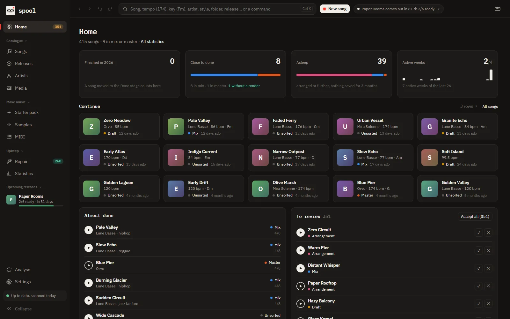
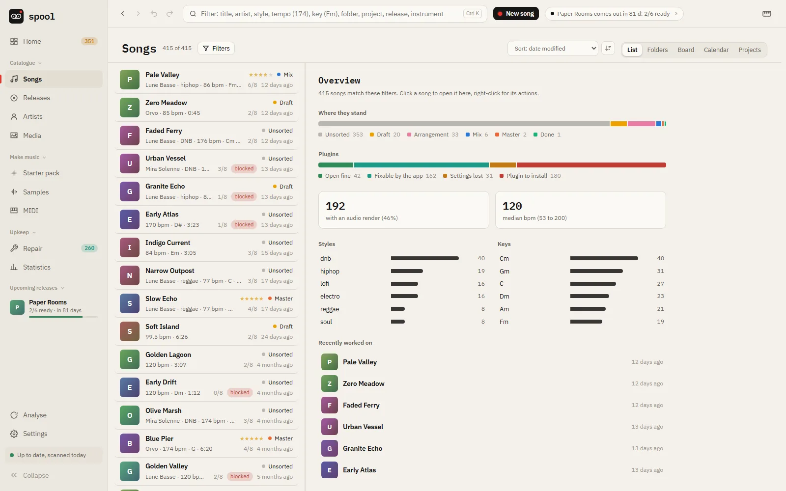
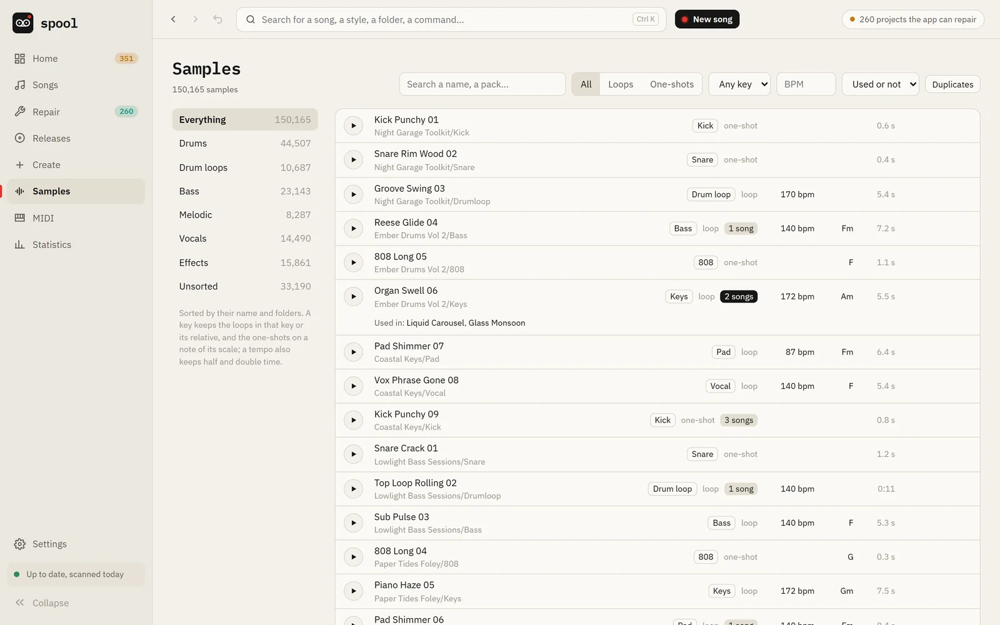
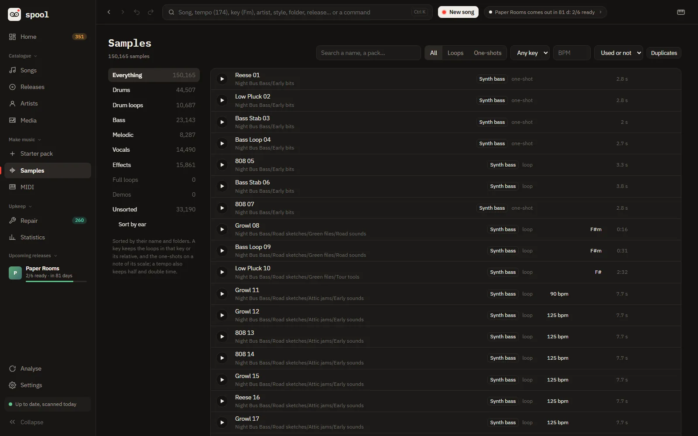
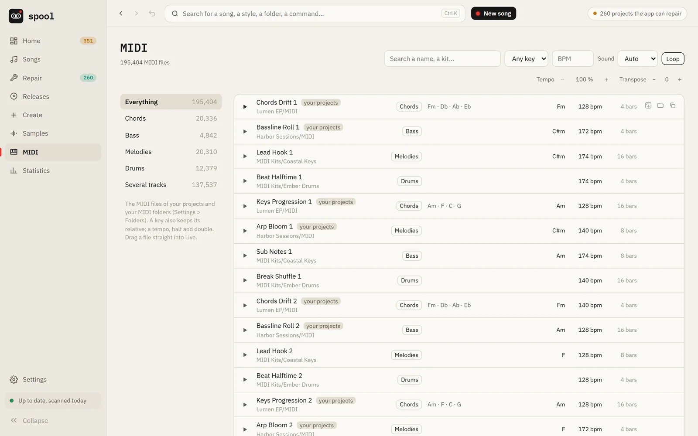
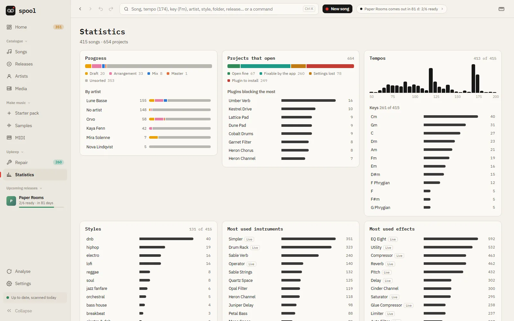
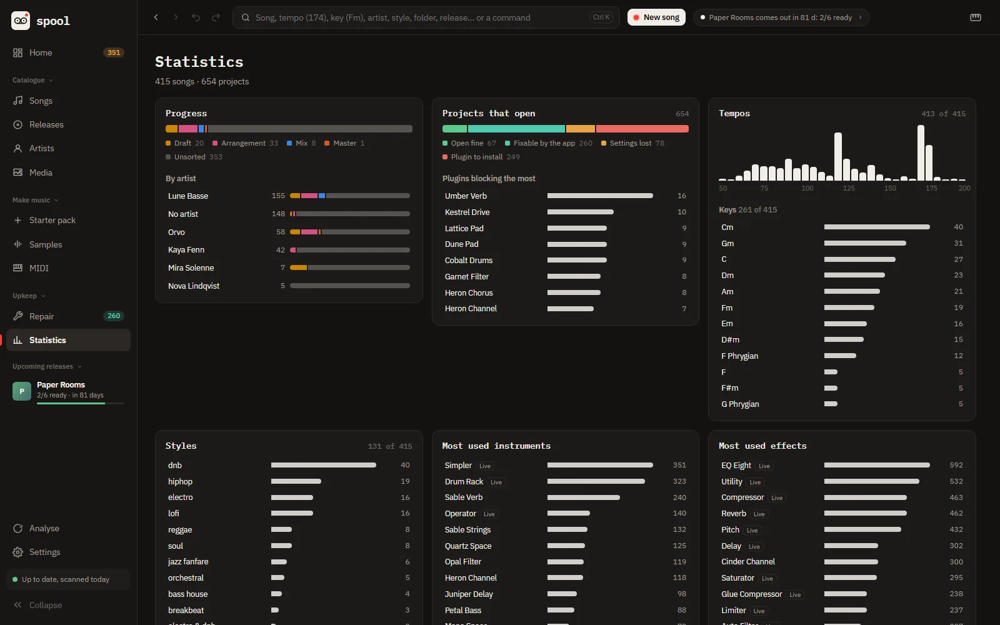
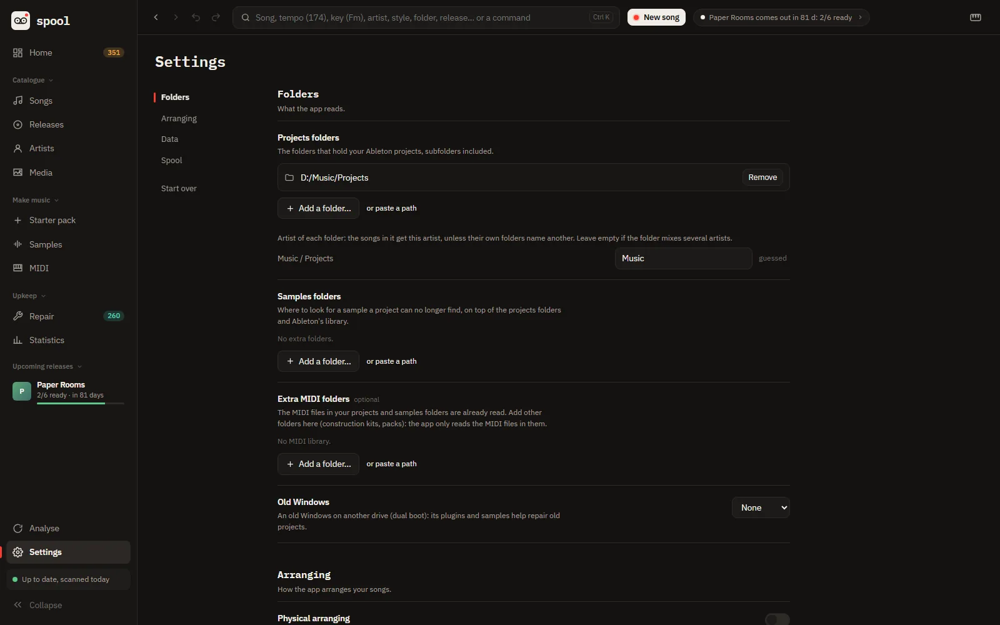

# Spool

**Your Ableton Live projects, organised, playable and repaired.** A free, open-source
desktop app for producers, by [Fatstep](https://fatstep.com/tools/spool).

Spool reads your project folders and turns years of `.als` files into a catalogue of
songs: one song per idea, however many versions. Listen to any project without opening
Live, follow its chords and progressions as it plays, compare your mixes with your
references, keep track of what each song still needs, and find your samples and MIDI again.
When a project no longer opens, Spool shows why and repairs it on a copy.

Free, open source, in English and French. Windows for now.

[](https://fatstep.com/tools/spool)

*A short look. The full tour, with sound, is on [the download page](https://fatstep.com/tools/spool).*

**What's new:** [CHANGELOG.md](CHANGELOG.md) lists every version, and each one has its
notes in [Releases](https://github.com/ftstp/spool/releases).

## Features

### Catalogue and organisation

- Every project grouped into songs: versions, working copies, older saves and renders,
  however your folders are laid out.
- Style, key and tempo filled in by themselves, from the project first and the audio to
  back it; hover a field to see where it comes from and pick another suggestion.
- Stage, rating, release date and notes per song; the stage Spool guesses is shown beside
  the one you set.
- List, board, calendar and folders views. Drag a song onto a day of the calendar to set its
  release date, or onto a folder to move it (asked first, undoable).
- Filters by theme (music, progress, technical), saved as presets you switch between, one of
  them applied at start.
- Global search by title, tempo (`174`, `170-175`), key (`Fm`, `F#m`, `Gbm`), artist,
  style, folder, project file, release or instrument, every word in any order.
- How Spool reads your folders, shown with your own examples: where a title comes from,
  which folders are a single song, each rule previewed before and after it applies.
- Split a song in two, attach one to another, gather a folder into one song, merge two
  artists: every change is undone with Ctrl+Z, and no file moves.
- Optional arranging of your folders on disk (off by default), each move checked and
  undoable.
- Song tabs you can reorder, resizable panes, Undo and Redo everywhere.

### Listen without opening Live

- Play a project straight from its `.als`: MIDI tracks through a built-in synth whose sound
  is guessed from each track's instrument, preset, name and effects; audio clips, Simpler
  and Drum Rack from their own samples, in time with the arrangement.
- Velocity, pitch bend and glide kept; a limiter keeps the sound clean.
- Mute and solo per track and per group (Ctrl+click adds to the solo), remembered per
  project; reference tracks and tracks muted in Live start muted.
- Playback starts at the first locator or the first bar that sounds, never on silence.
- Switch between the project and its render at the same point, from the player bar.
- Key control: transpose what plays a semitone at a time, without changing the tempo.
- The arrangement drawn from the project: tracks coloured by role, clips in place, MIDI
  clips with their notes, sections from your locators. Click the ruler to play from there.
- Play a release from start to end with previous and next.

### Chords and progressions

- A chord row under the arrangement that names the chord at the playhead, and a chord
  chart by section, four bars a line, repeats counted.
- Chord names in American (`Am7`), Latin (`La m7`) or degrees (`vi`), with slash basses
  (`F#m/A`) only when the bass holds them.
- A staff mode: the tune taken from the melody clips, written with real note values and
  rests under the time signature, with 8va and 8vb.
- The player bar shows the chord you hear and the next one, for any render.
- Click a bar to play from there; play every chord of the song in a row.
- Your song's loop, variations of it, and the well-known progressions of its mode in its
  key, to hear and drag into Live.
- What could come after a chord, by level and by style, each explained in a line, with the
  key's chords, the circle of fifths or a keyboard as an aid.
- Each MIDI clip shows its chords; hover it for its notes, range and velocities.
- Play a MIDI keyboard through Spool (piano, organ or electric piano).

### References and comparison

- Mark any audio file as a reference (a released track) for a song, an artist or a release.
- A/B between your render and another version or a reference, at the same moment and the
  same loudness.
- Loudness, peak, average level, dynamics, format and the balance of frequencies on one
  chart, with the gap range by range from sub to highs, at equal loudness.
- How much Spotify, Deezer or Apple Music would turn your track down.
- Timed comments on a render ("the drop is empty at 1:32"): added as you listen, ticked
  when dealt with, a click plays from there.
- What changed between two saves of a project: tempo, length, tracks added, removed or
  renamed, and each track's plugins, notes, clips and samples.

### The song sheet

- The render stays at the top with its waveform and comments while you scroll.
- Sections you open with a click or the keys 1 to 0: arrangement, chords, render,
  projects, resources, checklist, notes, mood board and more.
- Finishing checks: your own, saved as presets for every song or some; the cover, title,
  artist and lyrics tick themselves.
- Notes as separate items, each one tied to a moment of the render if you like.
- Resources: the samples the project plays (in the project, in a library, or missing), the
  unused ones in its folders, and its MIDI files, each playable and draggable into Live.
- Every version of the project, older ones included, opens in Live from the sheet.
- "Unstick this song": your own MIDI clips and loops that fit its key and tempo, heard
  alone or over the render from its next bar, then dragged into Live.

### Samples

- Your sample folders sorted by kind (kick, snare, bass, pad, vocals...), loop or one-shot,
  key and tempo; samples with an unhelpful name sorted by ear.
- Played faster or slower without changing the key, or locked to your song's tempo; loop
  button, previous and next.
- "Sounds alike" for every sample, and samples found from a song in its key (or relative)
  and tempo (or half or double).
- The songs that use each sample, the ones never used, and the duplicates with the space
  they take (nothing is ever deleted).
- Drag into Live, always as a copy.

### MIDI

- Your MIDI files and the MIDI clips written in all your projects (chords, basslines,
  melodies, beats), each once, with the song it comes from, by kind, key and tempo.
- Played by the built-in synth (piano, synth, bass, a real drum kit), transposed or
  retimed, then dragged into Live as you heard them, as a copy.
- Save any MIDI clip of a project as a file.

### Mood boards and media

- A mood board per song, release and artist: pictures, notes, lyrics, palette, fonts,
  presets, sounds and MIDI files, linked from anywhere on your disk without copying them.
- Drop files anywhere on a song's sheet to add them; send several media to a board at once.
- A Media page with every song's pictures, videos, fonts and presets, and the media outside
  your projects by folder.
- An Unused audio list: the sounds no song uses, ready to link as a render, a reference or
  a mood board item, with songs of a close name suggested first.
- Right-click any picture to make it the main picture of a song, a release or an artist.

### Artists and releases

- A sheet for every artist: a profile (contact, links, collecting society and IPI, notes),
  their songs, featurings, releases, styles, keys and tempos, a mood board and a photo.
- Singles, EPs and albums: tracklist with each track's style, key, tempo and last save,
  what is ready, notes, cover and mood board; suggested from your folders.
- Right-click a release or a track to rename, reorder, copy the tracklist or delete
  (undoable).

### Repair and upkeep

- When a project will not open (samples moved, a plugin renamed after a reinstall or a move
  to VST3, a project from another computer), Spool shows why in plain steps: repair at
  once, what to install first, the samples still lost.
- A repaired copy also gathers the samples found elsewhere into the project, like Live's
  Collect All and Save.
- Optional treatments, on a copy: track colours, names and order by role, cleanup of empty
  tracks and unused returns, section markers, a template (tempo, scale, master rack).
- Projects copied as they are into other folders flagged, with a way to archive the copy.
- Settings > Storage shows everything Spool keeps; the catalogue and its safety copy are
  compressed.

### Home, statistics and starter packs

- A Home page you arrange yourself: the figures at the top, the blocks below (every
  statistics chart included) and their order.
- A line at the top that turns through what is useful today: the next release, the song
  nearly done, an idea left aside, your week.
- Statistics on your whole catalogue.
- Starter pack: a starting project for a style, built from the devices and samples you
  actually use.

### Audio analysis

- On by default, can be turned off: from each song's render, the songs that sound alike,
  the measured tempo, and a style suggestion from the songs you already sorted.
- It runs on your computer with LAION's CLAP model
  ([`larger_clap_general`](https://huggingface.co/laion/larger_clap_general), Apache-2.0),
  downloaded once in the background after the first setup. It slows down while Live is open
  so Live does not crackle. See [crates/audio](crates/audio/README.md).

### Everywhere

- Light or dark theme, English or French.
- Nothing about you or your projects leaves your computer.

## Screenshots

| Light | Dark |
|---|---|
|  |  |
|  |  |
|  |  |
|  |  |
|  |  |
|  |  |
|  |  |
|  |  |
|  |  |

## What Spool writes

Spool reads your projects to build the catalogue. It writes only when you ask: a repair or a
treatment writes a new copy next to the original (`Song [R].als`), and arranging your folders
on disk (off until you turn it on in Settings) moves files, each move checked and undoable
with Ctrl+Z. Stages, releases, mood boards and the audio analysis live in the app's own
database.

## Download

Windows: **[fatstep.com/tools/spool](https://fatstep.com/tools/spool)**. The installer
needs no administrator rights. Spool checks for a new version shortly after it starts and
every 6 hours, and only offers it: nothing installs without your click. Updates are signed;
a download that does not carry Spool's signature is refused.

### "Unknown publisher" on the first install

Windows SmartScreen warns about the installer because it is not signed with a Windows
code-signing certificate. That is a deliberate choice for now: a certificate costs a few
hundred euros a year, requires an identity check of the publisher, and the SmartScreen
reputation it unlocks only builds up over time and downloads. For a free tool at its start,
we would rather wait. Click "More info", then "Run anyway".

What protects you meanwhile:

- the source code is here, and each release on the download page shows the installer's
  SHA-256 checksum, so you can check the file you got is the one published;
- every update is signed with Fatstep's own key (minisign, through Tauri's updater), and
  Spool refuses an update that does not carry that signature.

Spool sends nothing about you or your projects anywhere. Its only network request is that
update check (`artists.fatstep.com/spool/download/latest.json`), plus one download for the
audio analysis, in the background after the first setup unless you turn it off in Settings >
Spool: about 80 MB, once, the CLAP
audio model from this repository's releases on GitHub and Microsoft's ONNX Runtime from
Microsoft's releases on GitHub, each file checked against a SHA-256 written in the source.
Nothing is uploaded: the analysis runs on your computer, and "Remove the model" deletes the
download.

## Build from source

Requirements: Rust (stable, 1.85+), Node 20+ with pnpm, and on Windows the WebView2 runtime.

```
pnpm --dir web install
cargo test --workspace
cd apps/desktop
../../web/node_modules/.bin/tauri dev      # the app, with live reload
../../web/node_modules/.bin/tauri build    # an installer, in target/release/bundle
```

How it is put together: [docs/ARCHITECTURE.md](docs/ARCHITECTURE.md).

## Licence

GPL-3.0-or-later (see [LICENSE](LICENSE)). You may use, study, change and share Spool; a
modified version you distribute must stay under the same licence, with its source.

"Spool" and "Fatstep" are names of Fatstep; a fork must use another name.

The optional audio analysis downloads a model that is not part of Spool's source: LAION's
CLAP `larger_clap_general` (Apache-2.0, by LAION, <https://github.com/LAION-AI/CLAP>),
converted to ONNX by [`tools/clap/export.py`](tools/clap/export.py), and Microsoft's ONNX
Runtime (MIT). Their notices ship with the download.
