# Spool

**Your Ableton Live catalogue, sorted and repaired.** A free, open-source desktop app for
producers, by [Fatstep](https://artists.fatstep.com/spool).

Spool reads your project folders and turns years of `.als` files into a catalogue of
songs: one song per idea, however many versions, with its stage, style, key, tempo, renders
and mood board. When a project no longer opens, it shows why and repairs it on a copy.

Free, open source, in English and French. Windows for now.

[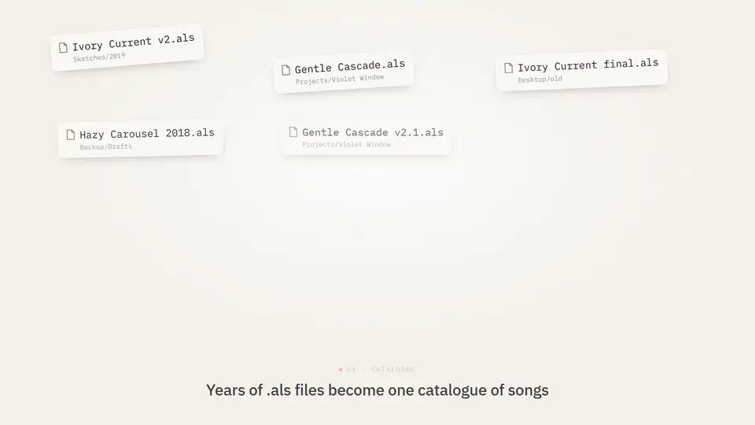](https://artists.fatstep.com/spool)

*A short look. The full tour, with sound, is on [the download page](https://artists.fatstep.com/spool).*

## Your files are never modified

This is the rule everything else follows.

- Spool **only reads** your projects. A repair writes a new copy next to the original
  (`Song [R].als`) and never overwrites anything, not even an earlier copy you reopened in
  Live (it writes `Song [R] 2.als`).
- Sorting, releases and mood boards live **in the app**. Files move on disk only if you turn
  on "Physical arranging" in Settings, and every move is checked (a project that would
  lose a sample stays put), journaled and undoable with Ctrl+Z.
- Every copy Spool wrote is listed in Repair > Written copies, so you can find them and
  tidy up yourself.

These guarantees are covered by tests (`cargo test --workspace`): a repair leaves the
original byte for byte, a second repair never overwrites the first, a move that fails
halfway puts everything back.

## What it does

Light or dark, as you like (Settings > Spool > Appearance):

| Light | Dark |
|---|---|
| 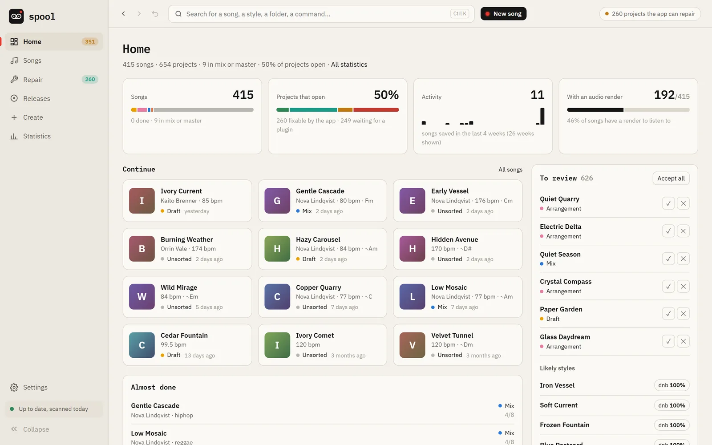 | 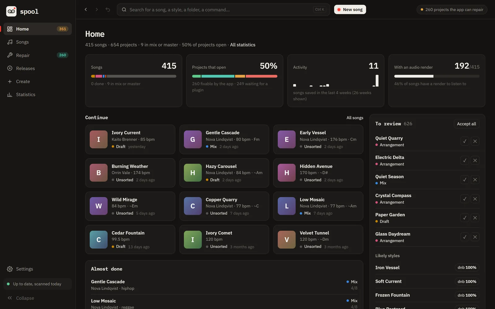 |
| 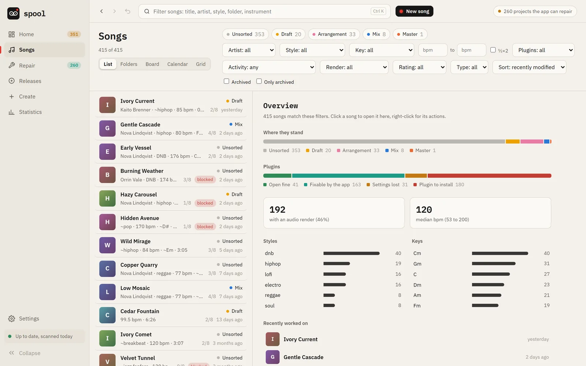 | 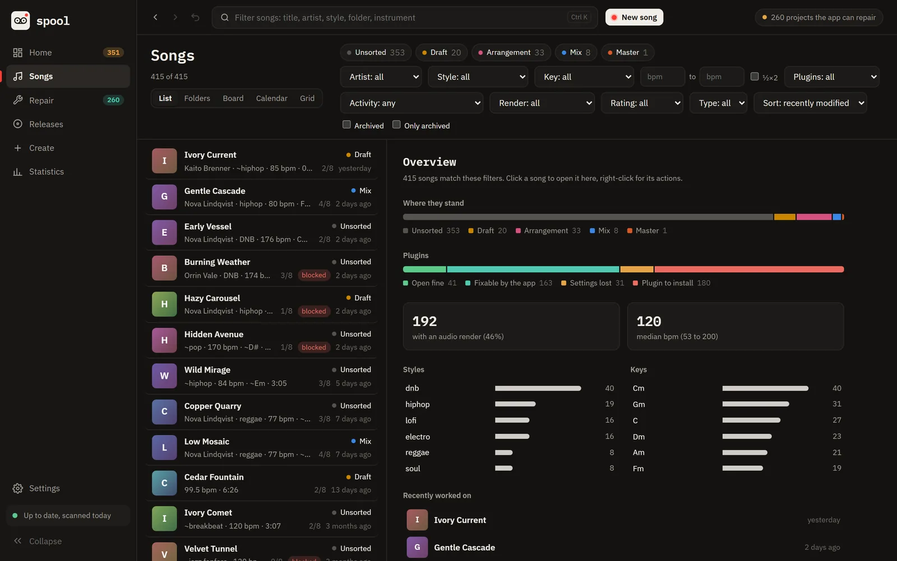 |
| 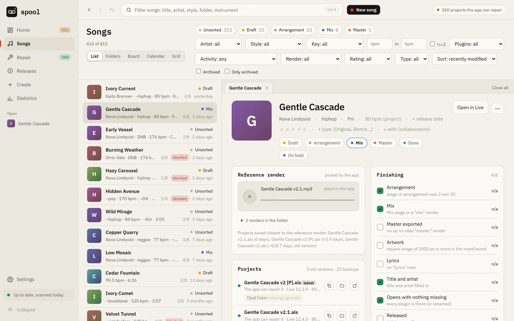 | 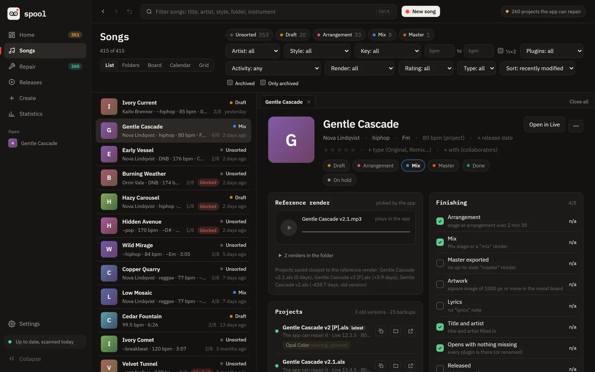 |
| 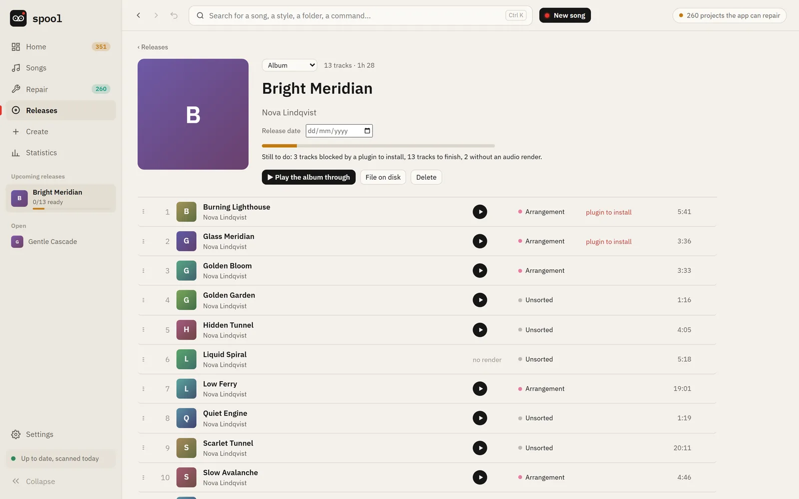 | 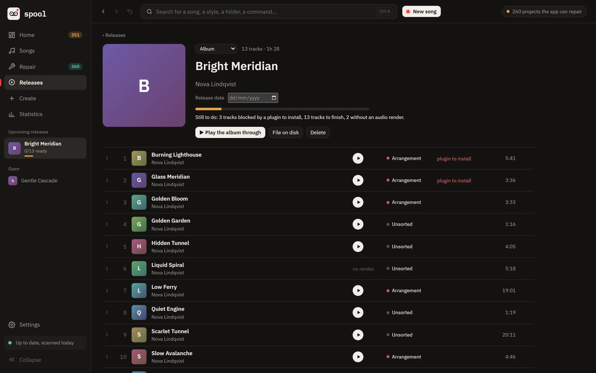 |
| 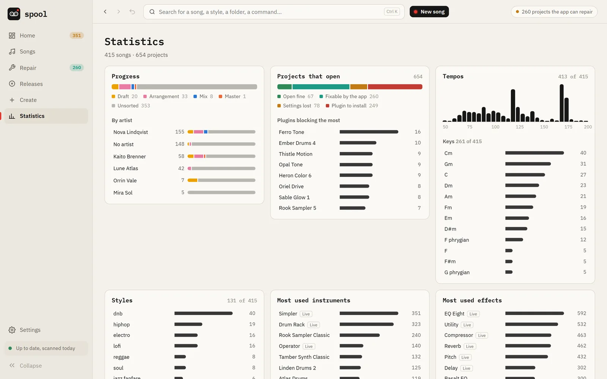 | 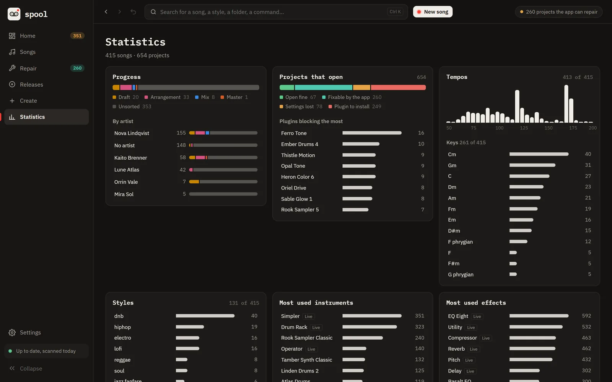 |
| 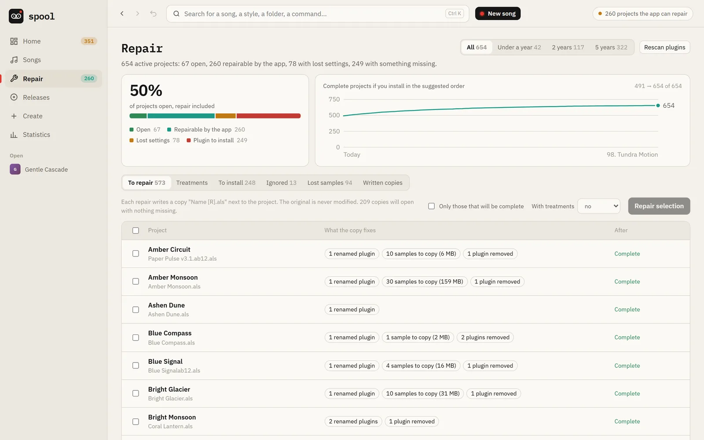 | 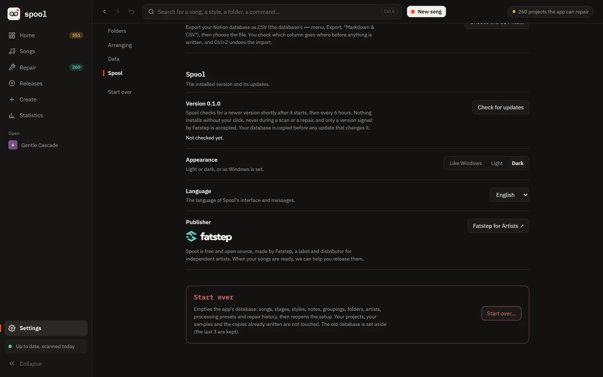 |


- **Catalogue**: every project grouped into songs (versions, working copies, renders),
  with stage, style, key, tempo, rating, notes. List, board, calendar, folders and grid
  views; global search; statistics.
- **Repair**: when a project will not open (samples moved, a plugin renamed after a
  reinstall or a move to VST3, a project from another computer), Spool shows why and
  writes a repaired copy next to it.
- **Treatments** (optional, on a copy): track colours, names and order by role, cleanup of
  empty tracks and unused returns, section markers, a template (tempo, scale, master rack).
- **Mood boards** per song (pictures, notes, lyrics, palette), linked from anywhere on
  your disk without moving anything.
- **Releases**: group songs into a single, EP or album, see what is ready.
- **Create**: a starting project for a style, built from the devices and samples you
  actually use.

## Download

Windows: **[artists.fatstep.com/spool](https://artists.fatstep.com/spool)**. The installer
needs no administrator rights. Spool checks for a new version shortly after it starts and
every 6 hours, and only offers it: nothing installs without your click. Updates are signed;
a download that does not carry Spool's signature is refused.

### "Unknown publisher" on the first install

Windows SmartScreen warns about the installer because it is not signed with a Windows
code-signing certificate. That is a deliberate choice for now: a certificate costs a few
hundred euros a year, requires an identity check of the publisher, and the SmartScreen
reputation it unlocks only builds up over time and downloads. For a free tool at its start,
we would rather wait. Click "More info", then "Run anyway".

What protects you meanwhile:

- the source code is here, and each release on the download page shows the installer's
  SHA-256 checksum, so you can check the file you got is the one published;
- every update is signed with Fatstep's own key (minisign, through Tauri's updater), and
  Spool refuses an update that does not carry that signature.

Spool sends nothing about you or your projects anywhere. Its only network request is that
update check (`artists.fatstep.com/spool/download/latest.json`).

## Build from source

Requirements: Rust (stable, 1.85+), Node 20+ with pnpm, and on Windows the WebView2 runtime.

```
pnpm --dir web install
cargo test --workspace
cd apps/desktop
../../web/node_modules/.bin/tauri dev      # the app, with live reload
../../web/node_modules/.bin/tauri build    # an installer, in target/release/bundle
```

How it is put together: [docs/ARCHITECTURE.md](docs/ARCHITECTURE.md).

## Licence

GPL-3.0-or-later (see [LICENSE](LICENSE)). You may use, study, change and share Spool; a
modified version you distribute must stay under the same licence, with its source.

"Spool" and "Fatstep" are names of Fatstep; a fork must use another name.
